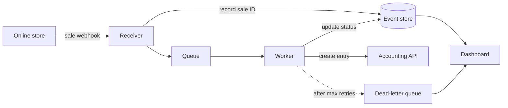

# OneEntry

Event-driven middleware that syncs online store sales into an accounting system automatically, with signature verification, idempotent processing, retries and a dead-letter queue.

> **Status:** in development. See the [roadmap](#roadmap) for what works today.


<!-- Replace with a 60-90 second recording: happy path, duplicate webhook, accounting API down, recovery. -->

## The problem

Small businesses often record every sale twice: once in the shop and once in the books. Someone copies the data by hand, mistakes creep in, and the accountant spends hours reconciling.

OneEntry removes that step. It receives a sale webhook from the store, verifies it, transforms it into an accounting entry and posts it to the accounting system. It is built to keep working when things go wrong: duplicate webhooks never create duplicate entries, temporary accounting outages are retried with backoff, and events that still cannot be delivered land in a dead-letter queue where they can be reviewed and retried from a dashboard.

Off-the-shelf tools cover the common Shopify-to-accounting case. This project demonstrates the reliability patterns you need when you have to build the integration yourself.

## How it works



1. **Receiver** exposes `POST /webhooks/sales`, verifies the HMAC signature and records the sale ID. A sale ID it has already seen is acknowledged but not processed again.
2. **Queue** decouples receiving from processing, so a slow or failing accounting API never causes a sale to be lost.
3. **Worker** transforms the sale into an accounting entry and posts it. Failures are retried with exponential backoff.
4. **Dead-letter queue** holds events that still fail after the maximum number of retries.
5. **Dashboard** shows synced, pending and failed events, with a retry button on failures.

## Key design decisions

- **Idempotency keys.** Webhooks are delivered at least once, so duplicates are normal. Each sale ID is recorded before processing, which makes repeated deliveries harmless.
- **Queue between receiver and worker.** The receiver can answer the store quickly and safely, and the worker can process at its own pace.
- **Retry with backoff, then dead-letter.** Temporary outages heal themselves. Permanent failures are kept visible instead of being silently dropped.
- **Accounting behind an interface.** The worker talks to an adapter, so the mock accounting API can be swapped for a real QuickBooks or Xero adapter without touching the core.
- **Correlation ID per sale.** Every log line for one sale shares an ID, so a failure can be traced from webhook to accounting call.

### What would change at 100x volume

- Shard the queue (for example per customer) and use FIFO queues only where ordering matters
- Run multiple workers and partition by customer or sale ID to preserve ordering where it matters
- Add RDS Proxy for connection pooling, a read replica for the dashboard, and an archive policy for old events
- Add rate limiting and back-pressure towards the accounting API

## Tech stack

- C# / .NET on AWS Lambda
- Amazon API Gateway, Amazon SQS (with a dead-letter queue) and Amazon RDS for PostgreSQL
- Amazon CloudWatch and AWS X-Ray for logs and tracing
- Dashboard (optional)
- GitHub Actions for CI/CD, deployed to AWS

## Getting started

### Prerequisites

- .NET SDK [version]
- An AWS account and the AWS CLI [version]

### Setup

```bash
git clone https://github.com/Pseudo-Lee/[repo-name].git
cd [repo-name]
cp .env.example .env
```

Fill in the values in `.env`:

| Variable | Description |
| --- | --- |
| `WEBHOOK_SECRET` | Shared secret used to verify incoming webhook signatures |
| `DATABASE_URL` | PostgreSQL connection string, or the Secrets Manager secret that holds it |
| `QUEUE_URL` | URL of the SQS queue the receiver sends to |
| `ACCOUNTING_API_URL` | Base URL of the accounting API (the bundled mock by default) |

### Run

```bash
dotnet restore
[build and deploy commands for your infrastructure tool]
```

### Simulate a sale

```bash
./scripts/simulate-sale.sh
```

Send the same sale twice to see idempotency in action, or stop the mock accounting API to see retries and the dead-letter queue.

## Running the tests

```bash
dotnet test
```

The test suite covers signature verification, duplicate webhooks, retry behaviour and the accounting-API-down case.

## Roadmap

- [ ] Webhook receiver with HMAC signature verification
- [ ] Transformation of sale payloads into accounting entries
- [ ] Mock accounting API
- [ ] Idempotent processing
- [ ] Queue and worker with retry and backoff
- [ ] Dead-letter queue
- [ ] Status dashboard with retry button
- [ ] Structured logging with correlation IDs
- [ ] Azure deployment with CI/CD
- [ ] Real accounting adapter (QuickBooks sandbox)
- [ ] Real store integration (Shopify development store)

## Known limitations

- Uses a mock accounting API only; no real accounting system is connected yet
- Single-tenant: one store and one accounting target

## Author

**Lethabo Chokoe**
[GitHub](https://github.com/Pseudo-Lee) · [LinkedIn](https://www.linkedin.com/in/lethabo-chokoe-228723256/) · [Portfolio](https://portfolio-lethabo.netlify.app/)

## License

Copyright (c) 2026 Lethabo Chokoe. All rights reserved.

The source is published for viewing and evaluation. No permission is granted to copy, modify, distribute or use it commercially without written permission.
